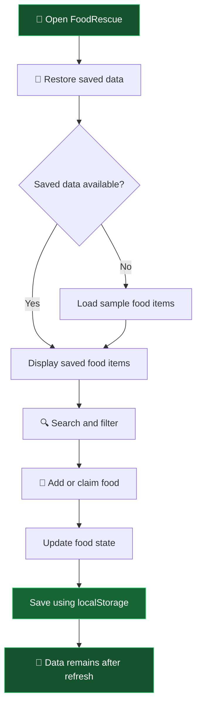

<div align="center">


### ♻️ Canteen Surplus Food Management System

**Discover surplus food. Claim a meal. Reduce waste.**

<p>
  
  
  
  
</p>

**🌱 Good food deserves a second chance.**

</div>

---

## 🥗 About FoodRescue

FoodRescue is a responsive web application concept designed to help college students discover and claim surplus food available in their canteen.

The project focuses on reducing food waste through a simple interface where users can browse food items, search by name, filter by category, add new items, and claim available food.

## ✨ Features

<table>
<tr>
<td width="50%">

### 🍱 Food Management
- Dynamic food cards
- Add new food items
- Claim available food
- Food status indicators
- Claimed items cannot be claimed again

</td>
<td width="50%">

### 🔍 Discovery & Experience
- Search food by name
- Filter by category
- Responsive layout
- Form validation
- Loading and error handling

</td>
</tr>
<tr>
<td width="50%">

### 💾 Data Persistence
- Browser-based `localStorage`
- Saves added food items
- Preserves claim statuses
- Restores data after refresh

</td>
<td width="50%">

### 🧮 JavaScript Demo
- Discount calculator
- Input validation
- Dynamic DOM rendering
- Asynchronous sample-data loading

</td>
</tr>
</table>

## 🧰 Tech Stack

<div align="center">

| Technology | Purpose |
|:---:|---|
| 🟠 **HTML5** | Semantic page structure and forms |
| 🔵 **CSS3** | Styling, layout, Flexbox/Grid and responsive design |
| 🟡 **JavaScript** | Application logic, validation, search, filtering and events |
| 💚 **localStorage** | Saving food data in the browser |

</div>

> **Current scope:** This version uses HTML, CSS, vanilla JavaScript, and browser `localStorage`. It does not currently use a backend, API, authentication system, or database.

## 🔄 How It Works



## 📁 Project Structure

```text
FoodRescue/
│
├── index.html    # Main webpage and forms
├── style.css     # Styling and responsive layout
├── script.js     # Food logic and localStorage
└── README.md     # Project documentation
```

## 🚀 Run the Project Locally

1. Clone or download this repository.
2. Open the project folder in Visual Studio Code.
3. Open `index.html` using Live Server.
4. Browse food items, use search and category filters, add food, and claim an available item.
5. Refresh the page to verify that saved food items and claim statuses are restored.

## 🧪 Try These Scenarios

- Search for a food item by name.
- Filter food items by category.
- Add a food item with valid details.
- Claim an available food item.
- Refresh the page and check whether the saved data remains.
- Test the discount example with amounts such as `500`, `501`, `1000`, and `1001`.

## 💾 How Data Storage Works

FoodRescue uses JavaScript `localStorage` to store food items as JSON.

```javascript
// Save food items
localStorage.setItem(
    "foodRescueFoodItems",
    JSON.stringify(foodItems)
);

// Restore food items
const savedItems = localStorage.getItem("foodRescueFoodItems");

if (savedItems !== null) {
    foodItems = JSON.parse(savedItems);
}
```

The actual application includes its own loading and validation logic around stored data.

**Storage limitations:**
- Data stays in the current browser and website origin.
- Clearing browser site data can remove saved food items.
- Data is not automatically shared between users or devices.
- `localStorage` is not a replacement for a shared server database.

## 🛣️ Future Improvements

Potential next steps for a future version:

- Node.js and Express backend
- PostgreSQL database
- User authentication and role-based access
- Shared food listings across devices
- Complete collection workflow
- Automated testing and deployment

*These are planned possibilities, not features claimed in the current version.*

---

<div align="center">

### 🌍 Rescue a Meal. Reduce Waste. Build a Better Campus.

**FoodRescue** 💚

*Built with HTML5, CSS3 and JavaScript.*

</div>
